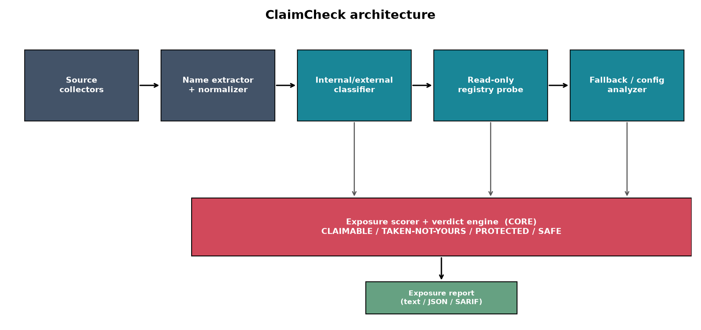
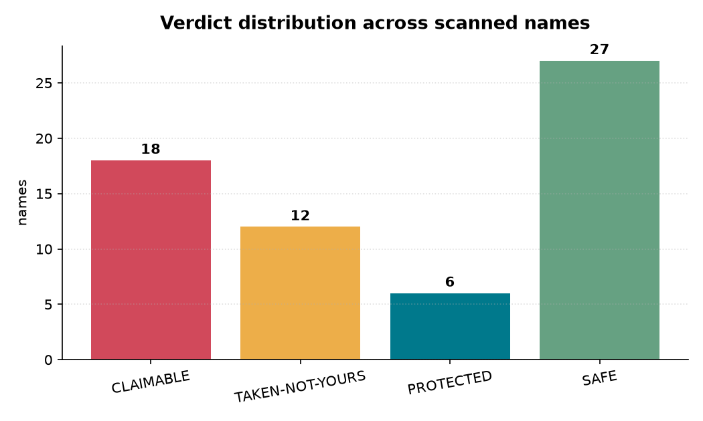
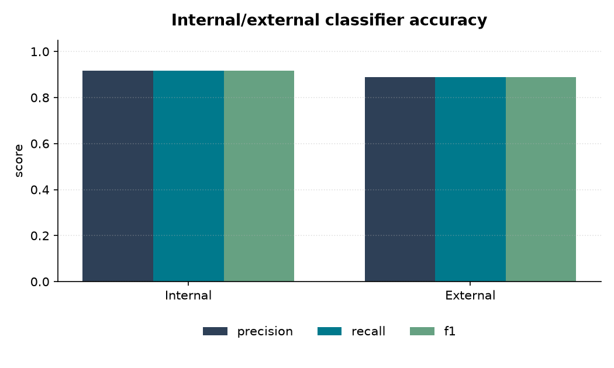
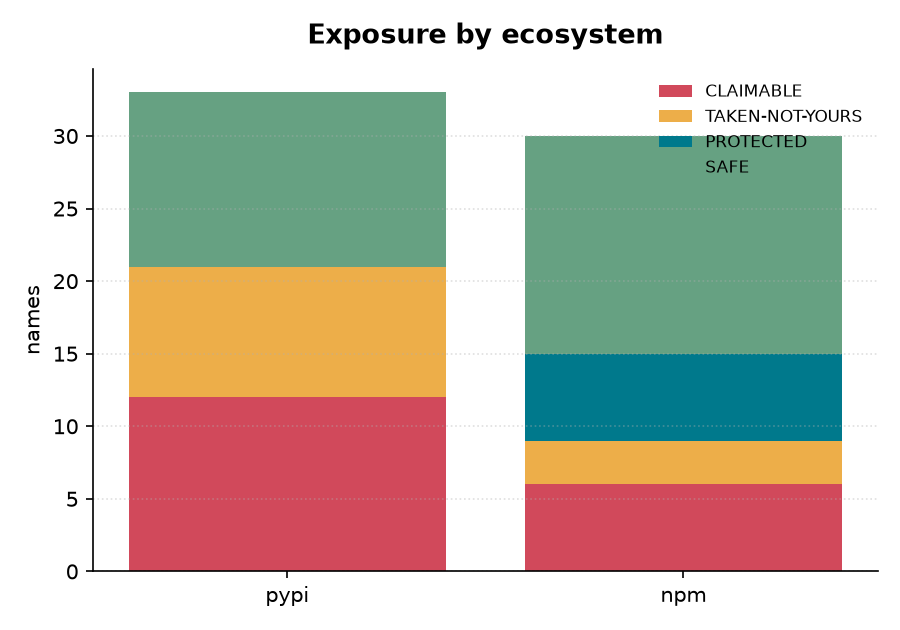
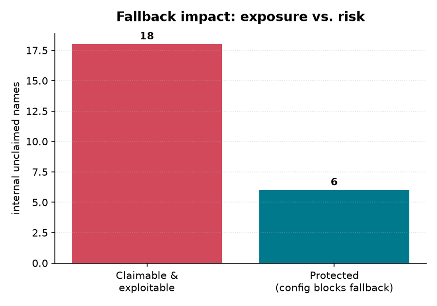
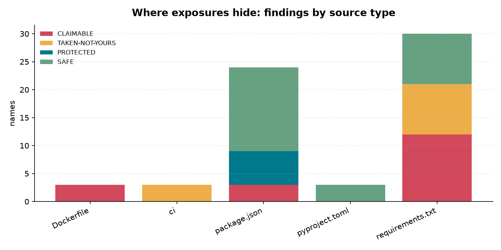
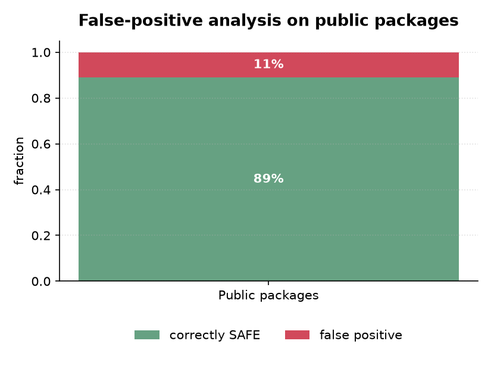

# ClaimCheck

**A defensive dependency-confusion exposure checker for internal packages.**

> Reads your internal package names and tells you which ones an attacker could
> claim on public PyPI/npm — surfacing a serious, specific supply-chain exposure
> in a five-minute scan.

*Author: Krishita Sanjay Choksi · License: MIT*


---

## Why this exists

Dependency confusion (a.k.a. the substitution attack) is one of the most elegant
and destructive supply-chain attacks documented — it burned Apple, Microsoft,
PayPal and dozens of others in a single disclosure. The mechanism is brutally
simple:

> Your build uses an internal package (`acme-auth`, `@acme/billing`) that lives
> only on a private registry. But most package managers, told to install
> `acme-auth`, will happily pull it from the **public** registry if a higher
> version exists there. An attacker who learns your internal name just publishes
> that name publicly with a huge version number — and your build silently pulls
> the attacker's code, which runs at install time.

The exposure is **invisible from inside**: your manifests look normal and your
builds work fine — right up until someone claims the name. It leaves no trace in
your code, so **no code scanner or CVE database checks it**. The exposure is a
*namespace fact*: does the public name exist, and would your install config fall
back to it?

**ClaimCheck makes that invisible exposure visible.** It reads the places internal
names leak or are declared, extracts the set of names your builds trust, checks
each against the public PyPI and npm registries, and answers the only question
that matters: *is this name unclaimed (an attacker could register it) or already
claimed (possibly already a squat)?* — then prints a prioritized, actionable
exposure report.

### What makes it novel

- **It inverts the attacker's recon into a defender's checklist.** The attacker's
  whole job is discovering your internal names and testing which are claimable.
  ClaimCheck runs that reconnaissance *for the defender, first*.
- **It closes a visibility gap, not a code gap.** The exposure is a namespace
  fact no SCA/CVE tool checks. A tool whose entire job is answering that question
  fills a real, specific hole.
- **Fallback-aware verdicts.** It distinguishes a name that is merely *unclaimed*
  from one that is unclaimed **and exploitable** because your install config
  permits public fallback. Exposure ≠ risk without that distinction.
- **Already-squatted detection.** It flags internal names that are already public
  and *not yours* — a squat that may already be live — which a naive "is it
  claimable?" check misses entirely.
- **Read-only and report-only.** It never registers, squats, or publishes
  anything. The deliverable is a risk report; remediation is the operator's
  deliberate action. An automated test enforces the read-only invariant.

---

## Architecture



*(Mermaid source: [`figures/architecture.mmd`](figures/architecture.mmd); the PNG
is generated by `experiments/make_figures.py`.)*

| Stage | What it does |
|---|---|
| **Source collectors** | Parse every place names hide: `requirements.txt`, `pyproject.toml`, `setup.py/cfg`, `Pipfile`, `poetry.lock`, `package.json`, `package-lock.json`, `yarn.lock`, `.npmrc`, `pip.conf`, Dockerfiles, and CI files. |
| **Name extractor + normalizer** | Dedup, tag each name with ecosystem + scope, apply PyPI (PEP 503) canonicalization so `Acme_Internal.Auth` and `acme-internal-auth` match. |
| **Internal/external classifier** | Decide which names are *meant to be private* using scope prefixes, an org allowlist, private `.npmrc` scopes, and the "not on the public registry" heuristic. Ignores well-known packages (`requests`, `lodash`). |
| **Read-only registry probe** | Query public PyPI + npm: does the name exist? who owns it? when was it first published? Strictly HTTP GET; cached. A mock oracle stands in for fully offline runs. |
| **Fallback / config analyzer** | Determine whether your config actually permits public fallback (reserved npm scope? pinned pip index?) — the difference between theoretical and exploitable. |
| **Exposure scorer + verdict engine** *(core)* | Fuse the signals into a deterministic, explainable verdict with a priority and cited evidence. |
| **Report generator** | Prioritized report with a per-name action, plus SARIF (CI code-scanning) and JSON (pipelines). |

---

## The four verdicts

| Verdict | Meaning | Typical action |
|---|---|---|
| 🔴 **CLAIMABLE** | Internal name, **unregistered** publicly, and your config permits public fallback → an attacker could register it and your build would pull it. | Defensively register the name; reserve the scope / pin the index. |
| 🟠 **TAKEN-NOT-YOURS** | Internal name that **already exists publicly and is not yours** → a possible existing squat. | Investigate the owner & publish date; if malicious, report and pin. |
| 🟦 **PROTECTED** | Unclaimed internal name, but scope reserved / index pinned → no public fallback. | Keep the config; **re-scan in CI** (a config change re-opens it). |
| 🟢 **SAFE** | Legitimately public and yours, or a well-known package. | None. |

---

## Results (reproducible benchmark)

Run against **3 synthetic organizations (63 labeled names)** whose ground truth
is assigned *by construction* — independent of the scorer — so the benchmark
measures whether the scorer reproduces the intended semantics rather than
grading itself.

| Metric | Value |
|---|---|
| Names analyzed | **63** (across 3 orgs) |
| Classification accuracy (internal vs external) | **90.5%** |
| Verdict accuracy (4-class) | **90.5%** |
| **CLAIMABLE** precision / recall / F1 | **1.00 / 1.00 / 1.00** |
| TAKEN-NOT-YOURS precision / recall | 0.75 / 0.75 |
| False-positive rate on public packages | **11.1%** |

The **critical class (CLAIMABLE) is caught with perfect precision and recall** on
this set — the tool never misses an exploitable, unclaimed internal name and
never cries wolf about one. The accuracy that is *not* 100% comes from two
**intentional adversarial edge cases** per org, kept in the benchmark for honesty:

1. **False negative** — an internal name with *no* naming signal that has already
   been squatted looks exactly like a normal public dependency without an
   operator allowlist.
2. **False positive** — a long-established public package that merely *collides*
   with an internal prefix gets over-flagged by the prefix heuristic.

Both are documented limitations with clear remediations (supply a `--config`
allowlist) in [`docs/threat_model.md`](docs/threat_model.md).

### Figures

| | |
|---|---|
|  |  |
|  |  |
|  |  |

All figures and metrics are **code-generated** and regenerable with
`make bench && make figures`.

---

## Sample exposure report

A worked report for the synthetic `acme` org (full versions in
[`reports/`](reports/)):

```
PRIO     ECO   NAME                              SOURCE            REGISTRY              VERDICT
------------------------------------------------------------------------------------------------
CRITICAL npm   acmecorp-config-loader            Dockerfile        unclaimed             CLAIMABLE
CRITICAL npm   acmecorp-internal-logger          ci                taken (mallory)       TAKEN-NOT-YOURS
CRITICAL npm   acmecorp-internal-ui              package.json      unclaimed             CLAIMABLE
CRITICAL pypi  acme-internal-auth                requirements.txt  unclaimed             CLAIMABLE
CRITICAL pypi  acme-internal-utils               requirements.txt  taken (mallory)       TAKEN-NOT-YOURS
HIGH     pypi  acme-tools                        requirements.txt  taken (thirdparty-dev)TAKEN-NOT-YOURS
MEDIUM   npm   @acme/payments                    package.json      unclaimed             PROTECTED
MEDIUM   npm   @acme/secrets                     package.json      unclaimed             PROTECTED
INFO     pypi  requests                          requirements.txt  taken (community)     SAFE
```

Every finding carries **cited evidence** — where the name was found, the registry
state, and the fallback reasoning — so a verdict is auditable, not a black box:

```
[CRITICAL] acme-internal-auth (pypi) -> CLAIMABLE
    action: Defensively register this name on the public registry now ...
      - classification: internal (matches internal prefix 'acme-')
      - found in: samples/acme/requirements.txt:6 [requirements.txt]
      - public registry: NOT FOUND (src=mock)
      - fallback: pip extra-index-url includes public PyPI (highest version wins across indexes)
```

---

## Remediation action table

| Verdict | Recommended fix (performed by **you**, deliberately) |
|---|---|
| CLAIMABLE | Register a stub of the name you control on the public registry; **and** reserve the npm scope (`@acme:registry=…`) / pin the pip index with no public `extra-index-url`. |
| TAKEN-NOT-YOURS | Investigate owner + publish date. If it is a squat, report to the registry and pin/replace the dependency. |
| PROTECTED | Keep the reserving config under change control; re-scan in CI so a regression is caught. |
| SAFE | No action. |

## Attack mechanics → ClaimCheck signal

| Step of a dependency-confusion attack | The ClaimCheck signal that catches it |
|---|---|
| Attacker discovers your internal name (leaked in a manifest, lockfile, Dockerfile, CI log) | **Source collectors** extract the same names from the same places |
| Attacker checks whether the name is free on the public registry | **Read-only registry probe** answers *exists? owner? when?* |
| Attacker relies on your build falling back to public | **Fallback analyzer** flags configs that permit fallback (exploitable) vs. reserved/pinned (protected) |
| Attacker publishes the name with a high version | **CLAIMABLE** verdict tells you to register/reserve it *first* |
| Attacker has *already* squatted the name | **TAKEN-NOT-YOURS** verdict (esp. recent publish by an unknown owner) |

---

## Install

Prereqs: Python ≥ 3.11 and `make` (optional). A clean clone runs **fully offline**
in mock mode.

```bash
git clone https://github.com/Krishita17/claimcheck.git
cd claimcheck
make setup          # creates .venv, installs offline deps + the package
```

Or manually:

```bash
python3 -m venv .venv && source .venv/bin/activate
pip install -r requirements.txt
pip install -e .
```

Live registry probing (Tier 2) is optional and needs `requests`:

```bash
pip install requests
```

---

## Usage

Everything below is copy-paste. The `make` targets wrap the same commands.

**1 — Generate the synthetic labeled data (deterministic):**

```bash
make data
```

**2 — Scan the bundled sample org (offline, mock registry):**

```bash
make scan
```

or directly:

```bash
claimcheck scan samples/acme \
  --oracle samples/acme.oracle.json \
  --config samples/acme.config.json
```

**3 — Scan your own repo against the live public registries:**

```bash
claimcheck scan /path/to/your/repo --live --config config/default.yml
```

**4 — Benchmark against ground-truth labels:**

```bash
make bench       # writes results/metrics.json + CSVs
```

**5 — Regenerate all figures and the sample reports:**

```bash
make figures
make report
```

**6 — Run as a CI gate (fail the build on a claimable internal name, emit SARIF):**

```bash
claimcheck scan . \
  --oracle oracle.json \
  --format sarif -o claimcheck.sarif \
  --fail-on claimable       # exit code 2 if any CLAIMABLE finding exists
```

`--fail-on` accepts `claimable`, `taken`, `any`, or `none`. See
[`.github/workflows/ci.yml`](.github/workflows/ci.yml) for a working SARIF-uploading
CI job.

---

## Repo layout

```
claimcheck/
├── src/claimcheck/
│   ├── collect/     source collectors (manifests, lockfiles, .npmrc/pip.conf, CI, Docker)
│   ├── extract/     name extractor + normalizer (PEP 503)
│   ├── classify/    internal-vs-external classifier
│   ├── registry/    read-only PyPI + npm probe (mock + live, cached)
│   ├── fallback/    scope/config fallback analyzer
│   ├── score/       exposure scorer + verdict engine  (the core)
│   ├── report/      text / markdown / JSON / SARIF renderers
│   └── data/        synthetic org + manifest generators, mock oracle, well-known lists
├── experiments/     benchmark.py, make_figures.py, configs
├── samples/         generated synthetic orgs + ground-truth labels + oracles
├── results/         generated metrics + CSVs
├── figures/         generated charts + architecture diagram
├── reports/         sample worked exposure reports
├── tests/           collectors, classifier, scorer, fallback, SARIF, read-only safety
└── docs/threat_model.md
```

---

## Reproducibility

- All synthetic data is produced deterministically from integer seeds
  (`make data SEEDS="0 1 2"`); the same seeds always yield the same orgs.
- Ground-truth labels, mock oracle fixtures, and classifier configs are written
  as committed JSON alongside each sample.
- `make reproduce` regenerates data → metrics → figures → reports from scratch.
- The full pipeline runs offline; live mode is opt-in.

## Limitations (honest)

- Verdicts reflect registry + config state **at scan time** — re-scan in CI.
- Without an operator allowlist, an already-squatted internal name with no naming
  signal can be missed; a public package colliding with an internal prefix can be
  over-flagged. Tune `--config` to resolve both. (Demonstrated in the benchmark.)
- The well-known package lists are small and high-signal, not a registry mirror;
  the live probe is authoritative about existence.

## Responsible use & ethics

ClaimCheck is for assessing **your own** dependency surface. It is **read-only**
against registries and **never publishes or registers anything** — remediation is
your deliberate action. It is **not** a mass-scanner for finding other
organizations' claimable names. All bundled examples use fictional,
operator-controlled names. Full detail in
[`docs/threat_model.md`](docs/threat_model.md).

## Supply-chain relevance

Dependency confusion sits at the intersection of package-manager resolution
behavior and supply-chain defense: a famous, high-impact attack whose *defensive
audit* side is thinly tooled. ClaimCheck fills that gap with a sharp,
CI-native, demonstrable result — the kind of pre-emptive check that belongs in
every build that consumes private packages.

## License

MIT © 2026 Krishita Sanjay Choksi. See [LICENSE](LICENSE).
